# Taller: patrón de diseño Command (sistema bancario)

Sistema de gestión de transacciones bancarias implementado con el patrón de diseño
**Command**: los canales de atención (cajero automático y canal digital) solicitan
operaciones —depósito, retiro, transferencia y consulta de saldo— sin conocer la lógica
interna de las cuentas.

## Diagrama de clases

El diagrama UML de este proyecto vive aquí, en Mermaid. Es la única fuente del
diagrama: no hay archivos `.dot` ni PDF que regenerar.

```mermaid
classDiagram
    direction TB

    %% Convenciones: * metodo abstracto, $ metodo estatico

    class Command {
        <<interface>>
        +ejecutar() void*
        +deshacer() void*
        +modificaEstado() boolean
        +descripcion() String
    }

    class DepositarCommand {
        -cuenta : CuentaBancaria
        -monto : double
        -ejecutada : boolean
        +DepositarCommand(cuenta, monto)
        +ejecutar() void
        +deshacer() void
        +descripcion() String
    }

    class RetirarCommand {
        -cuenta : CuentaBancaria
        -monto : double
        -ejecutada : boolean
        +RetirarCommand(cuenta, monto)
        +ejecutar() void
        +deshacer() void
        +descripcion() String
    }

    class TransferirCommand {
        -origen : CuentaBancaria
        -destino : CuentaBancaria
        -monto : double
        -ejecutada : boolean
        +TransferirCommand(origen, destino, monto)
        +ejecutar() void
        +deshacer() void
        +descripcion() String
    }

    class ConsultarSaldoCommand {
        -cuenta : CuentaBancaria
        +ConsultarSaldoCommand(cuenta)
        +ejecutar() void
        +deshacer() void
        +modificaEstado() boolean
        +descripcion() String
    }

    class CuentaBancaria {
        -numero : String
        -titular : String
        -saldo : double
        -bloqueada : boolean
        +CuentaBancaria(numero, titular, saldoInicial)
        +depositar(monto) void
        +retirar(monto) void
        +transferir(destino, monto) void
        +consultarSaldo() double
        +bloquear() void
        +desbloquear() void
        +getNumero() String
        +getTitular() String
        +isBloqueada() boolean
        +money(valor) String$
    }

    class CajeroAutomatico {
        -canal : String
        -historial : Deque~Command~
        -deshechos : Deque~Command~
        -bitacora : List~String~
        +CajeroAutomatico(canal)
        +ejecutar(comando) boolean
        +ejecutarSecuencia(comandos) void
        +deshacer() boolean
        +rehacer() boolean
        +operacionesPendientes() int
        +getBitacora() List~String~
        +getCanal() String
    }

    class OperacionInvalidaException {
        <<exception>>
        +OperacionInvalidaException(mensaje)
    }

    class Exception {
        <<exception>>
    }

    class Cliente {
        +main(args) void
    }

    %% Realizacion: cada comando concreto implementa la interfaz Command.
    Command <|.. DepositarCommand : implementa
    Command <|.. RetirarCommand : implementa
    Command <|.. TransferirCommand : implementa
    Command <|.. ConsultarSaldoCommand : implementa

    %% Dependencia: los comandos delegan la logica en el receptor.
    DepositarCommand --> CuentaBancaria : opera sobre
    RetirarCommand --> CuentaBancaria : opera sobre
    TransferirCommand --> CuentaBancaria : opera sobre
    ConsultarSaldoCommand --> CuentaBancaria : opera sobre

    %% Dependencia: el invocador solo conoce la interfaz, nunca la clase concreta.
    CajeroAutomatico ..> Command : conoce solo la interfaz

    %% La excepcion de negocio: la declara la interfaz, la lanza el receptor
    %% y la captura el invocador (que la convierte en un rechazo).
    Command ..> OperacionInvalidaException : declara throws
    CuentaBancaria ..> OperacionInvalidaException : lanza
    CajeroAutomatico ..> OperacionInvalidaException : captura
    OperacionInvalidaException <|-- Exception : extends

    %% El cliente es el unico que conoce las clases concretas.
    Cliente ..> CuentaBancaria : crea
    Cliente ..> CajeroAutomatico : configura
    Cliente ..> DepositarCommand : crea
    Cliente ..> RetirarCommand : crea
    Cliente ..> TransferirCommand : crea
    Cliente ..> ConsultarSaldoCommand : crea
```



## Estructura del proyecto (organizada por rol del patrón)

```text
Command/
├── src/
│   ├── Cliente.java                         CLIENT     monta el sistema y ejecuta el escenario
│   └── modelos/                             RECEIVER   (lógica de negocio)
│       ├── CuentaBancaria.java                        depositar, retirar, transferir, consultar
│       ├── OperacionInvalidaException.java            error de negocio controlado
│       ├── command/                        COMMAND
│       │   ├── Command.java                           interfaz: ejecutar() / deshacer()
│       │   ├── DepositarCommand.java                  comando concreto
│       │   ├── RetirarCommand.java                    comando concreto
│       │   ├── TransferirCommand.java                 comando concreto
│       │   └── ConsultarSaldoCommand.java             comando concreto (no altera el estado)
│       ├── invocadores/                    INVOKER
│       │   └── CajeroAutomatico.java                  canal: ejecutar, deshacer, rehacer, lotes, bitácora
│       └── pruebas/                        VERIFICACIÓN
│           └── PruebasCommand.java                    18 pruebas de comportamiento
├── bin/                                    salida compilada
└── lib/                                    dependencias
```

| Carpeta / archivo | Rol del patrón | Responsabilidad |
|---|---|---|
| `modelos/` | Receiver | Toda la lógica de negocio y las validaciones de la cuenta. |
| `modelos/command/` | Command + ConcreteCommand | Una orden por operación; guarda receptor y parámetros y delega en el receptor. |
| `modelos/invocadores/` | Invoker | El canal: dispara comandos, deshace/rehace y registra la bitácora. |
| `src/Cliente.java` | Client | Crea receptores, comandos y canales, y los configura. |
| `modelos/pruebas/` | — | Batería de pruebas de comportamiento del sistema. |

## Compilar y ejecutar

```bash
javac -encoding UTF-8 -d bin $(find src -name "*.java")

# escenario de demostración (5 transacciones)
java -cp bin Cliente

# pruebas automáticas
java -cp bin modelos.pruebas.PruebasCommand
```

En Visual Studio Code basta con abrir el proyecto: `src` es la carpeta de fuentes y `bin`
la de salida (ver `.vscode/settings.json`).

## Guía de estudio

`patron-command.md` documenta el patrón (participantes, variantes, ventajas y errores
comunes) y es la base teórica de este taller.
